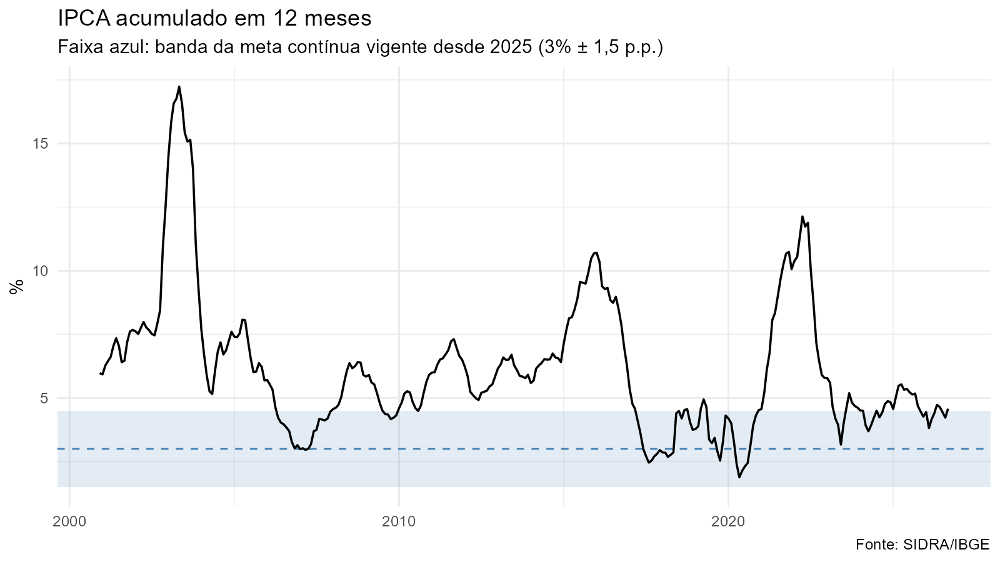
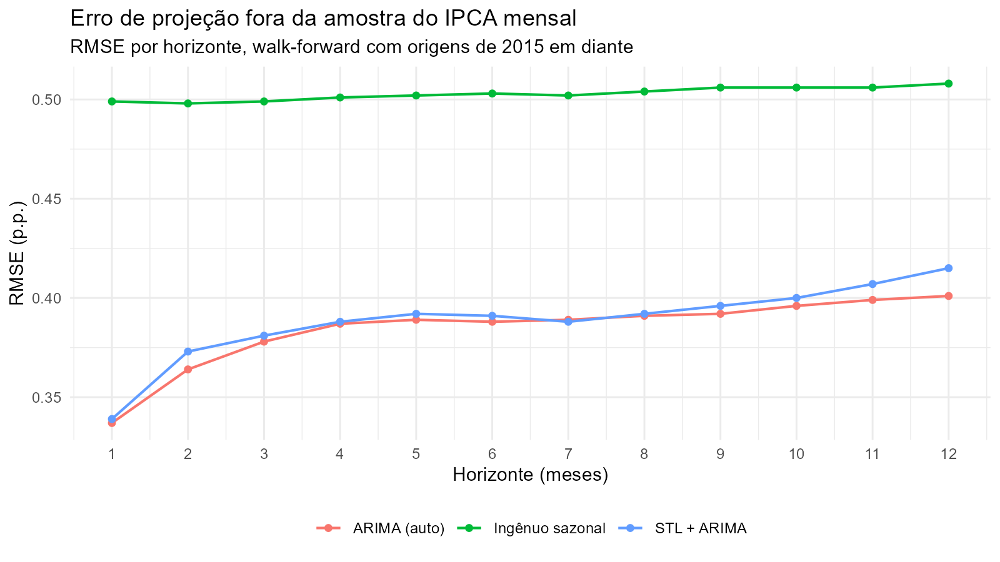
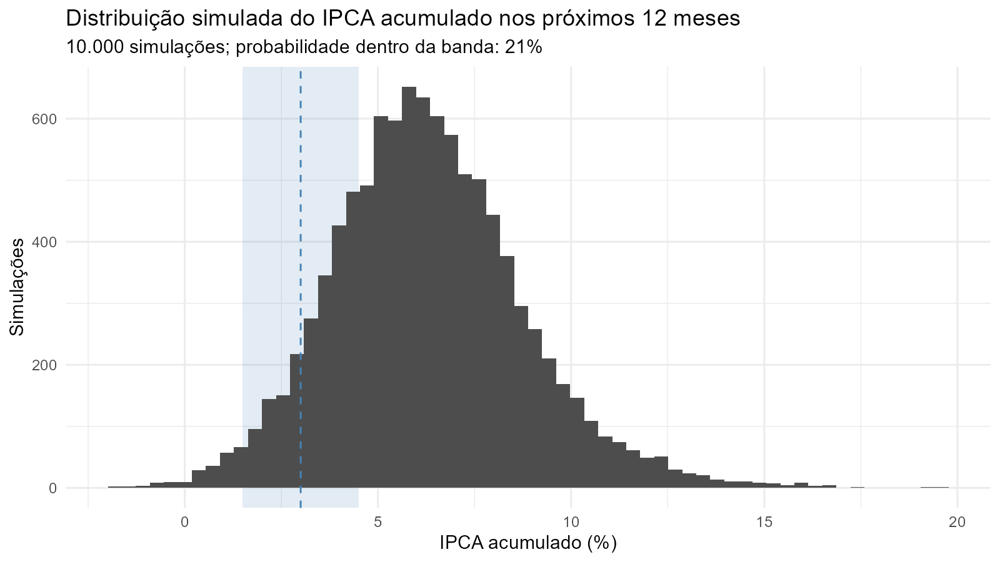

# Projeção do IPCA e probabilidade de cumprimento da meta

**Pergunta:** qual a inflação esperada para os próximos 12 meses e qual a probabilidade de o IPCA ficar
dentro da banda da meta do Banco Central (3% ± 1,5 p.p.)?

Pipeline reprodutível em R: os dados vêm direto da API do SIDRA/IBGE, e todas as tabelas e figuras são
geradas pelo código, sem números digitados à mão.



## Metodologia

| Etapa | Script | O que faz |
|---|---|---|
| 1. Coleta | `R/01_coleta.R` | IPCA mensal desde jan/2000 (SIDRA, tabela 1737) |
| 2. Diagnóstico | `R/02_diagnostico.R` | Decomposição sazonal STL; testes ADF e KPSS (hipóteses nulas opostas) |
| 3. Validação | `R/03_walkforward.R` | Walk-forward com janela expansiva: em cada mês desde 2015, o modelo é reestimado só com os dados disponíveis até ali e projeta 1 a 12 meses à frente |
| 4. Probabilidade | `R/04_prob_meta.R` | 10.000 trajetórias simuladas do ARIMA com resíduos reamostrados (bootstrap), para o acumulado em 12 meses e para o ano-calendário |

Modelos comparados: ingênuo sazonal (benchmark), ARIMA sazonal selecionado por critério de informação
(`auto.arima`) e STL + ARIMA.

## Resultados

**Erro fora da amostra.** Os dois modelos ARIMA reduzem o RMSE entre 20% e 33% frente ao benchmark
ingênuo sazonal em todos os horizontes (tabela completa em `output/tables/rmse_por_horizonte.csv`).



**Probabilidade de cumprir a meta** (`output/tables/probabilidade_meta.csv`):



## Limitações e próximos passos

- O ARIMA reverte para a **média histórica desde 2000** (cerca de 6% ao ano), acima da meta atual de 3%.
  Por isso, as projeções tendem a superestimar a inflação quando as expectativas estão ancoradas.
  Próximo passo: estimar em amostra mais recente ou modelar o desvio em relação à meta.
- Comparar as projeções com as expectativas do **Boletim Focus** (API do BCB, pacote `rbcb`).
- Incluir variáveis explicativas (câmbio, IGP, expectativas) em um modelo ARIMAX.
- Atualizar o pipeline automaticamente todo mês com GitHub Actions.

## Como reproduzir

```r
# Pacotes: jsonlite, readr, forecast, tseries, ggplot2, tidyr
# Na raiz do repositório:
source("run_all.R")
```

## Estrutura

```
ipca-forecast/
├── R/                 # scripts numerados, na ordem do pipeline
├── data/              # IPCA mensal baixado do SIDRA
├── output/
│   ├── figures/       # gráficos gerados pelo código
│   └── tables/        # tabelas de resultados (CSV)
└── run_all.R          # roda tudo, da coleta às figuras
```

---
Autor: Cezar Cherfen Ragonha · [LinkedIn](https://www.linkedin.com/in/cezar-cherfen-ragonha-33797b246/)
